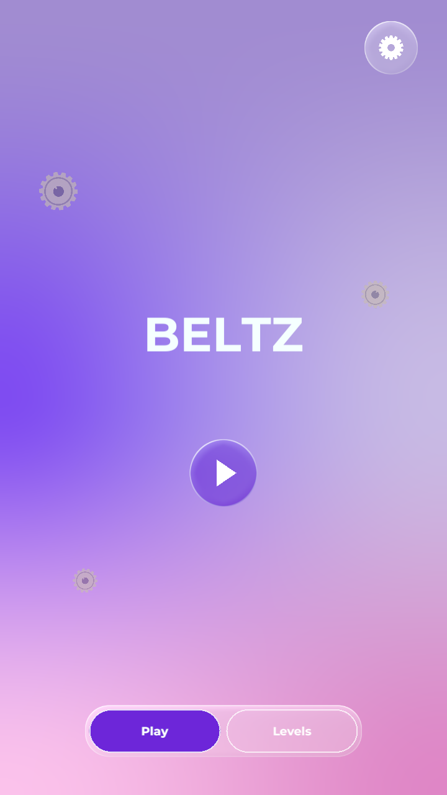
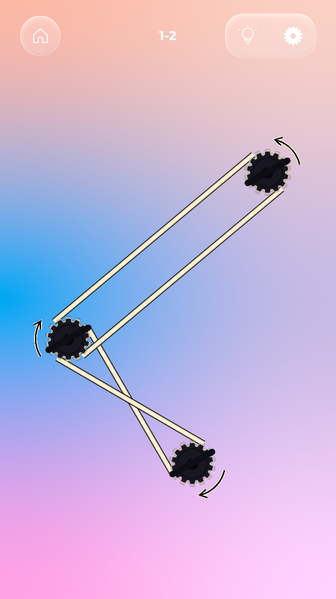
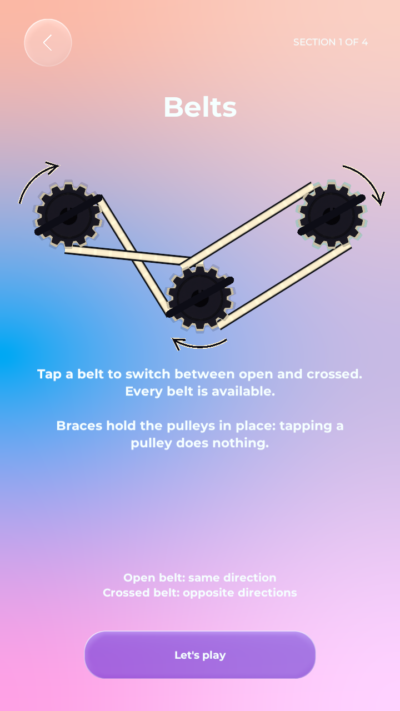
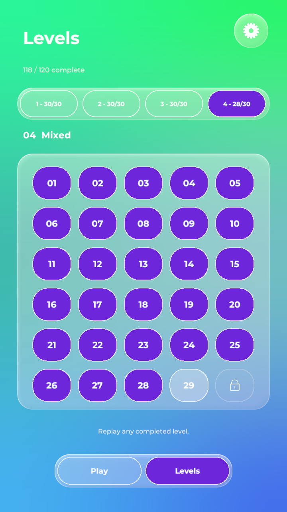

# Beltz

A puzzle game about pulleys and belts. Match every connection to set the machine in motion: open belts connect pulleys turning in the same direction; crossed belts connect opposite directions.

## Features

- **120 levels across four sections.**
- **Four rule sets:** switch belts, switch connected belts by tapping pulleys, reverse pulley directions, or combine both actions with locked elements.
- **Progressive unlocks:** complete 10 levels in a section to unlock the next. Replay completed levels from the level browser.
- **Interactive tutorials** for every section, with practice boards that run when solved.
- **Procedural level generation** with verified solvability, adjustable difficulty and varied pulley positions, distances and connection counts.
- **Hints, undo and restart.**
- **Saved progress and session recovery.**
- **Independent music and sound controls.**
- **Glass interface** with animated controls and Montserrat 500/700 typography.

## Screenshots

  
  

  
  

